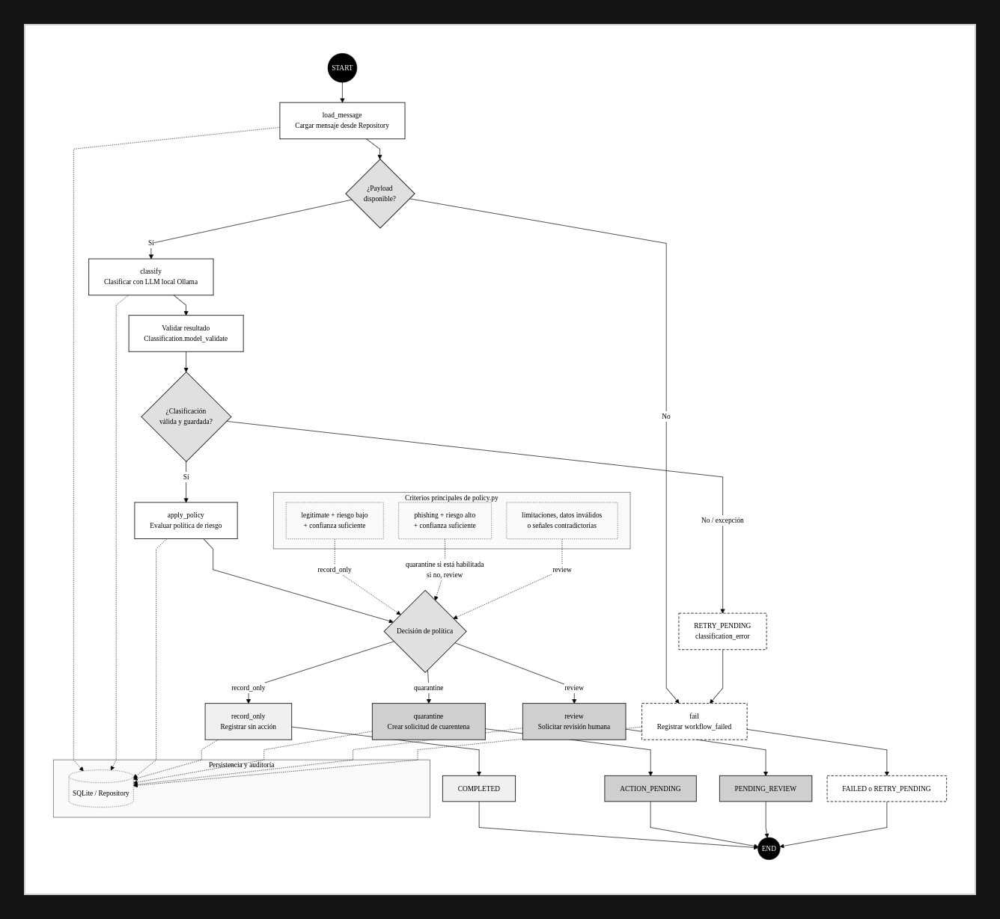

# Phishing Guard — prototipo de laboratorio

Orquestación de detección de phishing por correo con LangGraph, un LLM local servido por Ollama, SQLite e IMAP sobre TLS.

> **Estado:** scaffold inicial. La clasificación automática y el movimiento a cuarentena deben validarse en un buzón de laboratorio antes de habilitarse. La cuarentena automática está desactivada por defecto.

## Arquitectura



1. `imap_source.py`: escucha cambios IMAP con IDLE, busca mensajes no leídos y obtiene el RFC822.
2. `normalization.py`: extrae cabeceras, texto, HTML convertido a texto y URLs.
3. `repository.py`: guarda mensajes, resultados, trabajos y auditoría en SQLite.
4. `graph.py`: LangGraph coordina clasificación, política y ejecución de acciones.
5. `classifier.py`: un modelo local de Ollama devuelve JSON validado mediante Pydantic.
6. `policy.py`: decide entre registrar, revisión humana o cuarentena.
7. `cli.py`: comandos para inicializar DB, procesar mensajes ya guardados y revisar pendientes.

El módulo de adquisición no es un agente. La clasificación es un solo nodo de agente; la política y las acciones son lógica determinista.

## Requisitos

- Python 3.11+
- Servidor IMAP de laboratorio con TLS y una cuenta dedicada
- Ollama instalado y un modelo instruct descargado
- Crear una carpeta IMAP `Quarantine` (o ajustar `.env`)

## Instalación

```bash
python -m venv .venv
source .venv/bin/activate
pip install -e ".[dev]"
cp .env.example .env
ollama pull qwen2.5:7b
phishing-guard init-db
```

Editar `.env`. No usar una cuenta de producción. El certificado TLS debe validarse; no se recomienda desactivar la validación.

## Uso

Inicializar la base de datos:

```bash
phishing-guard init-db
```

Ejecutar adquisición continua con IMAP IDLE:

```bash
phishing-guard listen
```

Procesar mensajes ya persistidos:

```bash
phishing-guard process-pending
```

Ver casos pendientes de revisión:

```bash
phishing-guard review
```

El comando `review` es una consola interactiva básica. Las acciones solo se ejecutan contra la cuenta de laboratorio configurada.

## Flujo de estados

`RECEIVED -> ANALYZING -> CLASSIFIED -> ACTION_PENDING / PENDING_REVIEW -> COMPLETED`

Los fallos técnicos se registran como `RETRY_PENDING` o `FAILED`, no como clasificación legítima.

## Límites y seguridad

- No abre ni ejecuta adjuntos. Solo registra nombre, MIME y tamaño.
- No sigue ni visita URLs. Las URLs se extraen como indicadores.
- El correo se trata como contenido no confiable: las instrucciones incluidas en él no deben modificar las instrucciones del modelo.
- SQLite guarda contenido de correo en claro en el prototipo; restringir permisos del archivo y usar un disco cifrado si corresponde.
- El ejemplo no incluye envío de notificaciones por correo. El resultado se audita y se expone para la consola.
- IMAP IDLE indica cambios de buzón; después se consulta `UNSEEN` y se compara con los mensajes ya almacenados.
- En esta versión se marca como leído solo después de persistirlo. La adquisición no espera a la clasificación para marcarlo como leído.
- El movimiento IMAP se comprueba y registra; la semántica exacta de `move` depende del servidor. Probar con mensajes desechables primero.
- La clasificación de un LLM no es una probabilidad calibrada. Los umbrales son provisionales y la cuarentena automática está desactivada inicialmente.
- El conjunto GoPhish por sí solo no permite medir falsos positivos ni demostrar discriminación frente a correo legítimo.

## Pruebas

```bash
pytest
```

Las pruebas unitarias no requieren IMAP ni Ollama; la integración real requiere servicios de laboratorio.
